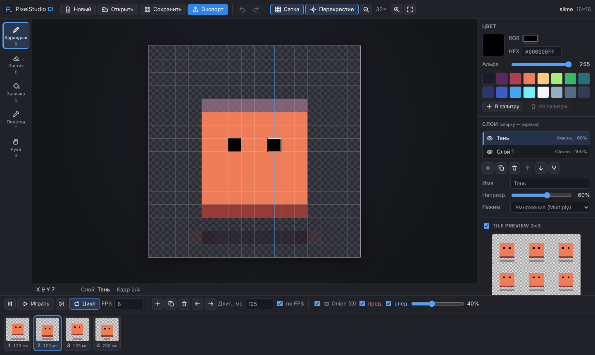

# PixelStudio CI

[](https://github.com/Gosha8046/PixelStudio-CI/actions/workflows/ci.yml)
[](https://github.com/Gosha8046/PixelStudio-CI/actions/workflows/pages.yml)

**PixelStudio CI** — пиксельный редактор игровых спрайтов, тайлов и покадровой анимации. Он работает **в браузере** без установки и **на Windows** как отдельное приложение. Вся логика — пиксели, слои, кадры, история, сохранение и экспорт — написана на C# в одной библиотеке, которую используют обе платформы.

- Веб-версия: `https://gosha8046.github.io/PixelStudio-CI/`. Появится после [настройки Pages](#github-pages) и первого успешного запуска workflow `Deploy web to GitHub Pages`.
- Windows: ZIP во вкладке **Releases**. Появляется после публикации тега `v*.*.*` (см. [релизы](#релизы-windows)).

> Значки выше показывают **фактический** статус запусков GitHub Actions. Workflow-файлы подготовлены и проверены локально (`actionlint`, а также те же команды сборки, тестов и E2E). В GitHub их выполнение и публикация пока не подтверждены: см. [что проверено](#что-проверено).



## Содержание

- [Возможности](#возможности-mvp)
- [Выбор технологий](#выбор-технологий)
- [Архитектура и модель данных](#архитектура-и-модель-данных)
- [Горячие клавиши](#горячие-клавиши)
- [Локальный запуск, сборка, тесты](#локальный-запуск-сборка-тесты)
- [CI/CD: GitHub Actions](#cicd-github-actions)
- [Производительность (замеры)](#производительность-замеры)
- [Что проверено](#что-проверено)
- [Ограничения](#ограничения)
- [Следующий этап](#следующий-этап)

## Возможности (MVP)

Сквозной сценарий: **создать проект → нарисовать спрайт → добавить слои и кадры → воспроизвести анимацию → сохранить проект → экспортировать PNG и JSON**.

**Холст и инструменты**
- Холсты 16×16, 32×32, 64×64 и произвольного размера **от 1 до 512 px** по каждой стороне.
- Пиксели хранятся в плоском массиве `Color32[]` (RGBA8, прямая альфа).
- Карандаш, ластик, заливка (scanline, без рекурсии), пипетка (из всех видимых слоёв или только из активного).
- Основной цвет: выбор RGB, HEX `#RRGGBBAA`, ползунок альфы. Палитра на 16 цветов (до 64) с добавлением и удалением; сохраняется в проекте.
- Целочисленный масштаб 1–64× без размытия (колесо мыши, кнопки), перемещение холста (инструмент «Рука», пробел или средняя кнопка мыши), переключаемая пиксельная сетка с крупной линией каждые 8 px.
- Undo/Redo для рисования **и** структурных изменений. При быстром движении указателя карандаш рисует непрерывную линию (Брезенхэм между событиями), и **один жест отменяется одним Undo**.

**Слои**
- Создание, переименование (двойной щелчок или поле «Имя»), удаление, независимое дублирование (копируются пиксели всех кадров).
- Порядок, видимость, непрозрачность 0–100 %, режимы **Normal, Multiply, Screen**.
- Объединение с нижним слоем с проверкой результата: если один слой не может точно передать режим смешивания, UI предупреждает (подробнее — в [архитектуре](docs/architecture.md#объединение-с-нижним-слоем)).

**Покадровая анимация**
- Таймлайн с миниатюрами. Создание, удаление, перестановка, независимое дублирование кадров.
- FPS (1–60) и собственная длительность любого кадра (1–60000 мс). Кадр без своей длительности длится `round(1000/FPS)`.
- Воспроизведение, пауза, зацикливание (сохраняется в проекте и в JSON).
- Onion Skinning: предыдущий кадр с красным оттенком, следующий — с синим, регулируемая прозрачность, включение каждой стороны отдельно.

**Инструменты для геймдева**
- Tile Preview: текущий кадр повторяется сеткой 3×3 и обновляется во время рисования (режим просмотра).
- Pixel Crosshair: рамка точно по пикселю под курсором и направляющие по его строке и столбцу. Рисуется в экранных пикселях с учётом zoom и devicePixelRatio.
- Горячие клавиши для инструментов, Undo/Redo, воспроизведения, кадров и вида. Не срабатывают при вводе текста и работают в любой раскладке.

**Файлы**
- Собственный формат `.pxstudio` (JSON + zlib + Base64) с версией формата и понятными сообщениями об ошибках: [описание](docs/project-format.md).
- Предупреждение о несохранённых изменениях: диалог в приложении перед «Новый» и «Открыть»; в браузере — `beforeunload`, в Windows — запрос при закрытии окна.
- Экспорт: PNG текущего кадра с прозрачностью; PNG-спрайтшит всех кадров с настройкой числа столбцов и отступов + JSON. [Формат, схема, пример и совместимость с движками](docs/export-format.md).

## Выбор технологий

### Стек: .NET 10 + Blazor (WebAssembly для браузера, BlazorWebView/WebView2 для Windows)

| Слой | Браузер | Windows |
|---|---|---|
| **Кто выполняет C#** | Среда .NET, скомпилированная в **WebAssembly** (Blazor WebAssembly). В интерпретаторе или с AOT-компиляцией в WebAssembly | Обычная **нативная .NET 10** (JIT); WebAssembly не используется |
| **Кто отображает** | **HTML5**: DOM для интерфейса и **Canvas 2D** (`putImageData`, `image-rendering: pixelated`) для пикселей | Тот же HTML/CSS/Canvas, отрисованный **WebView2** (движок Chromium Edge) внутри окна WinForms |
| Общий код | `PixelStudio.Core` (модель и алгоритмы) + `PixelStudio.UI` (Razor-компоненты) | те же сборки |
| Файлы | Скачивание и `<input type=file>` | Нативные `OpenFileDialog`/`SaveFileDialog` |

**WebGL не используется.** WebAssembly здесь только среда выполнения C#; рисует браузер обычным Canvas 2D API. Для пиксельной графики этого достаточно: изображение собирается на C#, а на экран переносится одним `putImageData` изменённого прямоугольника.

**Почему этот стек**
- Один C#-код ядра и один UI для обеих платформ. Хосты занимают около 300 строк.
- Все компоненты официальные, от Microsoft, под лицензией MIT. .NET 10 — LTS с поддержкой до ноября 2028 ([политика поддержки](https://dotnet.microsoft.com/en-us/platform/support/policy/dotnet-core)).
- DOM-интерфейс можно полноценно проверять end-to-end (Playwright), и сценарий реально прогоняется в Chromium.
- Сборка обеих платформ идёт через `dotnet` CLI; Windows-проект собирается даже на Linux (`EnableWindowsTargeting`).

**Рассмотренные альтернативы**
- **Godot 4 + C#** (исходный план в README): по официальной документации Godot C#-проекты на Godot 4 [пока нельзя экспортировать в Web](https://docs.godotengine.org/en/latest/tutorials/export/exporting_for_web.html) ([статус поддержки платформ](https://godotengine.org/article/platform-state-in-csharp-for-godot-4-2/)). Требование «C# в браузере» этим стеком не выполняется.
- **Avalonia (Browser + Desktop):** рабочий вариант, но по её документации [файловые пикеры в браузере полноценно поддерживаются только в Chromium](https://docs.avaloniaui.net/docs/services/storage/storage-provider), а холст без DOM сложнее тестировать end-to-end.
- **.NET MAUI:** нет браузерной цели.

**Проверено по документации** ([Blazor на GitHub Pages](https://learn.microsoft.com/en-us/aspnet/core/blazor/host-and-deploy/webassembly/github-pages?view=aspnetcore-10.0), [Blazor Hybrid для Windows Forms](https://learn.microsoft.com/en-us/aspnet/core/blazor/hybrid/tutorials/windows-forms?view=aspnetcore-10.0), [showSaveFilePicker на MDN](https://developer.mozilla.org/en-US/docs/Web/API/Window/showSaveFilePicker), [пользовательские workflow для Pages](https://docs.github.com/en/pages/getting-started-with-github-pages/using-custom-workflows-with-github-pages)):
- **GitHub Pages:** приложение должно знать базовый путь `/<репозиторий>/`. Workflow берёт его из `actions/configure-pages` и переписывает `<base href>`. Каталоги `_framework`/`_content` при публикации через Actions-артефакт не фильтруются Jekyll.
- **WebView2:** нужен WebView2 Runtime (есть в Windows 11 и обновляемой Windows 10). При его отсутствии приложение показывает сообщение со ссылкой на загрузку. Профиль WebView2 хранится в `%LOCALAPPDATA%\PixelStudioCI`, поэтому приложение работает и из каталога только для чтения.
- **Файлы в браузере:** страница не может писать на диск. File System Access API (`showSaveFilePicker`) экспериментальный и не входит в Baseline (нет в Firefox и Safari), поэтому сохранение сделано через скачивание и работает во всех современных браузерах.

### Ограничения стека (компромиссы, принятые до реализации)

- Браузерное «Сохранить» = **скачать файл**: нельзя перезаписать уже открытый файл, а имя и папку определяют настройки загрузок браузера. В Windows Ctrl+S пишет в тот же файл.
- Первая загрузка веб-версии около 2,5 МБ gzip в режиме интерпретатора или 4,8 МБ с AOT, который включён для Pages. Затем ресурсы кешируются браузером.
- В интерпретаторе WebAssembly пиксельные циклы в 5–7 раз медленнее нативных. Поэтому есть инкрементальная перерисовка, а Pages собирается с AOT (см. [замеры](#производительность-замеры)).
- Windows-сборка требует WebView2 Runtime; самодостаточный пакет весит около 50 МБ в ZIP (около 120 МБ распакованным): .NET runtime + WinForms + WebView2 loader. Подписи кода нет, поэтому SmartScreen может предупредить при первом запуске.

### Зависимости и лицензии

| Компонент | Где | Лицензия |
|---|---|---|
| .NET 10 SDK/Runtime, ASP.NET Core Blazor | везде | MIT |
| `Microsoft.AspNetCore.Components.WebAssembly` 10.0.14 | Web | MIT |
| `Microsoft.AspNetCore.Components.WebView.WindowsForms` 10.0.120 | Windows | MIT |
| `Microsoft.Web.WebView2` (транзитивно) | Windows | BSD-подобная, текст в [THIRD-PARTY-NOTICES.md](THIRD-PARTY-NOTICES.md) (кладётся в ZIP релиза) |
| WebView2 Runtime | Windows, в пакет не входит | лицензия Microsoft (предустановлен или ставится пользователем) |
| xUnit, Test SDK, coverlet; Playwright | только тесты | Apache-2.0 / MIT |

Сторонних библиотек обработки изображений нет: PNG-кодер (zlib через `System.IO.Compression`) и все алгоритмы свои. Это убирает лицензионные ограничения (например, у ImageSharp своя Split License) и даёт одинаковый результат на обеих платформах. Палитра и иконки нарисованы для проекта. Лицензия проекта — MIT ([LICENSE](LICENSE)).

## Архитектура и модель данных

Подробно: [docs/architecture.md](docs/architecture.md).

```
src/
  PixelStudio.Core/        модель и алгоритмы, без зависимостей (net10.0)
    Imaging/               Color32, PixelRect, DirtyRect
    Core/                  Canvas, Layer, LayerManager, Compositor, SpriteDocument, Palette, DocumentLimits
    Core/History/          UndoHistory, PixelEditCommand, StructureCommand, DocumentStructure
    Animation/             Frame, Timeline, PlaybackClock
    Editing/               ToolController
    Rendering/             ViewRenderer (экран: Onion Skin, инкрементальная перерисовка)
    IO/                    ProjectSerializer, Exporter, PngEncoder
    Diagnostics/           PerfProbe
  PixelStudio.UI/          общий интерфейс: Razor-компоненты, EditorState, KeyMap, pixelstudio.js/.css
    Platform/              IFileService, IPlatformShell — контракты платформ
  PixelStudio.Web/         хост для браузера (Blazor WebAssembly) + Platform/Browser*
  PixelStudio.Windows/     хост для Windows (WinForms + BlazorWebView) + Platform/Windows*
tests/
  PixelStudio.Tests/       xUnit: алгоритмы, история, форматы, экспорт, логика редактора (98 тестов)
  e2e/                     Playwright: полный сценарий в Chromium по опубликованной сборке
tools/PixelStudio.Bench/   нативные замеры и генерация примера экспорта
docs/                      архитектура, форматы, JSON Schema, примеры, roadmap
```

Структура из задания скорректирована. `Core/Exporter` и `ProjectSerializer` лежат в `IO/` внутри Core: им не нужен доступ к файлам, они возвращают байты, а записывают их платформенные адаптеры. UI выделен в Razor Class Library, чтобы два хоста использовали один интерфейс.

**Модель:** `SpriteDocument` содержит общий стек `Layer` (индекс 0 — нижний) и список `Frame`. В каждом кадре ровно один `Canvas` на слой (`Dictionary<layerId, Canvas>`), поэтому каждый слой хранит свои пиксели в каждом кадре. Дублирование всегда копирует массивы.

**Композиция:** снизу вверх; прямая альфа; формулы W3C Compositing Level 1: `Cs' = (1−αb)·Cs + αb·B(Cb,Cs)`, `αo = αs + αb(1−αs)`, `Co = (αs·Cs' + αb·Cb·(1−αs))/αo`; `B` = `Cs` / `Cb·Cs` / `Cb+Cs−Cb·Cs`; округление к ближайшему.

## Горячие клавиши

Клавиши привязаны к физическим кнопкам и работают в русской раскладке. Пока фокус в текстовом поле, они отключены.

| Действие | Клавиша | Действие | Клавиша |
|---|---|---|---|
| Карандаш | `B` | Отменить | `Ctrl+Z` |
| Ластик | `E` | Повторить | `Ctrl+Y`, `Ctrl+Shift+Z` |
| Заливка | `G` | Воспроизведение / пауза | `P` |
| Пипетка | `I` | Предыдущий / следующий кадр | `,` / `.` |
| Рука (панорама) | `H`, удерживать `Пробел`, средняя кнопка | Onion Skin | `O` |
| Масштаб | колесо, `+` / `−`, `0` — вписать | Tile Preview | `T` |
| Сетка | `Ctrl+'` | Перекрестие | `X` |
| Сохранить | `Ctrl+S` | Открыть | `Ctrl+O` |
| Экспорт | `Ctrl+Shift+E` | Закрыть диалог | `Esc` |

## Локальный запуск, сборка, тесты

Нужен [.NET SDK 10.0](https://dotnet.microsoft.com/download/dotnet/10.0) (`global.json` допускает 10.0.100 и новее в линейке 10.0). Для E2E-теста нужен Node.js 20+.

```bash
git clone https://github.com/Gosha8046/PixelStudio-CI.git
```

```bash
cd PixelStudio-CI
```

**Веб-версия, локально** (dev-сервер, откройте адрес из вывода, обычно `http://localhost:5xxx`):

```bash
dotnet run --project src/PixelStudio.Web
```

**Windows-версия** (только на Windows 10/11 с WebView2 Runtime):

```bash
dotnet run --project src/PixelStudio.Windows
```

**Сборка всего решения** (на Linux и macOS Windows-проект тоже компилируется, но не запускается):

```bash
dotnet build PixelStudio.slnx -c Release
```

**Модульные тесты:**

```bash
dotnet test tests/PixelStudio.Tests -c Release
```

**Публикация веб-версии** (статические файлы в `publish/web/wwwroot`):

```bash
dotnet publish src/PixelStudio.Web -c Release -o publish/web
```

Опционально — AOT-сборка, как для Pages: быстрее в 5–7 раз, но собирается дольше и весит больше. Нужен workload:

```bash
dotnet workload install wasm-tools
```

```bash
dotnet publish src/PixelStudio.Web -c Release -p:RunAOTCompilation=true -o publish/web
```

**E2E-тест в Chromium** по опубликованной сборке. Скрипт сам поднимает статический сервер с базовым путём `/PixelStudio-CI/`, как на GitHub Pages:

```bash
cd tests/e2e && npm ci && npx playwright install chromium && node run-e2e.mjs ../../publish/web/wwwroot --out output --perf
```

Просмотр опубликованной сборки в браузере: `http://127.0.0.1:5055/PixelStudio-CI/`.

```bash
node tests/e2e/static-server.mjs publish/web/wwwroot
```

**Windows-пакет вручную** (self-contained, папка целиком):

```bash
dotnet publish src/PixelStudio.Windows -c Release -r win-x64 --self-contained true -o publish/win-x64
```

**Нативные замеры и пример экспорта:**

```bash
dotnet run -c Release --project tools/PixelStudio.Bench
```

```bash
dotnet run -c Release --project tools/PixelStudio.Bench -- --sample docs/examples
```

## CI/CD: GitHub Actions

| Workflow | Когда | Что делает |
|---|---|---|
| [`ci.yml`](.github/workflows/ci.yml) | pull request, вручную | Linux: restore → build всего решения (включая Windows-хост) → unit-тесты (TRX как артефакт) → publish веба. E2E: Playwright/Chromium проходит полный сценарий по этой сборке, выводит замеры и проверяет экспортированный JSON по JSON Schema. Windows-раннер: сборка Windows-хоста и тесты |
| [`pages.yml`](.github/workflows/pages.yml) | push в `main`, вручную | Тесты → `configure-pages` (базовый путь) → AOT-publish → замена `<base href>` → **E2E по той же сборке** → загрузка артефакта → `deploy-pages` |
| [`release.yml`](.github/workflows/release.yml) | тег `v*.*.*` | Windows-раннер: тесты → self-contained publish `win-x64` с версией из тега → ZIP всей папки (exe + DLL + WebView2Loader + wwwroot + LICENSE/NOTICES) + ZIP веб-сборки + `SHA256SUMS.txt` → GitHub Release (`gh release create --generate-notes`; при повторном запуске — замена файлов) |

**Права и секреты.** Секреты не нужны, в репозитории их нет. Используется только встроенный `GITHUB_TOKEN` с минимальными правами: `contents: read` для CI; `pages: write` + `id-token: write` для деплоя; `contents: write` для создания релиза. Все action'ы официальные (`actions/*`), используются их Node 24-версии.

### GitHub Pages

1. Settings → Pages → Build and deployment → **Source: GitHub Actions**.
2. Сделайте push в `main` или запустите workflow «Deploy web to GitHub Pages» вручную (Actions → Run workflow).
3. Адрес появится в окружении `github-pages` (обычно `https://<user>.github.io/<repo>/`). Базовый путь берётся из `configure-pages`, поэтому переименование репозитория или свой домен не требуют правок.

Если в Settings → Environments → `github-pages` настроены правила защиты, деплой разрешён только из ветки `main`.

### Релизы (Windows)

```bash
git tag v0.1.0
```

```bash
git push origin v0.1.0
```

Тег с дефисом (`v0.2.0-beta.1`) создаёт pre-release. Пакет — ZIP: распакуйте его целиком и запустите `PixelStudio.exe` (рядом с ним должны лежать DLL и папка `wwwroot`).

## Производительность (замеры)

Цифры получены `PerfProbe` (один и тот же C#-код) и E2E-сценарием в контейнере разработки: 4 vCPU, Linux, Chromium 1.63 headless. Это ориентиры для сравнения режимов, а не гарантии. Синтетические данные: 4 слоя (Normal, Multiply, 60 %, Screen), около 70 % пикселей заполнено случайными цветами со случайной альфой.

| Операция | Native .NET 10 | WASM, интерпретатор | WASM, AOT |
|---|---:|---:|---:|
| Композиция 64×64, 4 слоя | 0,5–0,7 мс | 4,1–5,1 мс | 0,7–0,9 мс |
| Композиция 256×256, 4 слоя | 5,2–5,7 мс | 73–88 мс | 10,9–13,4 мс |
| Полный кадр 256×256 + Onion Skin | 20–29 мс | 317–384 мс | 46 мс |
| Заливка 512×512 (открытая область) | 2,3–3,0 мс | 101–114 мс | 7,1–9,7 мс |
| Заливка 512×512 (лабиринт, худший случай) | 1,2–1,4 мс | 39–51 мс | 3,9–5,2 мс |
| Спрайтшит 16 кадров 64×64 (PNG + JSON) | 35–48 мс | 156–199 мс | 35–52 мс |
| Сохранение проекта (64×64, 4 слоя × 16 кадров) | 51–71 мс | 64–124 мс | 42–66 мс |

Диапазоны — результаты нескольких запусков в одной среде. Сохранение и экспорт упираются в zlib: в WebAssembly это нативный код, поэтому разница с .NET на десктопе там небольшая.

Запуск веб-версии до готового редактора: около 1,3–1,5 с (локальный сервер; по сети добавится время загрузки).

**Задержка рисования** (событие указателя → C# → изображение на canvas), E2E, 2 слоя, Onion Skin включён:

| Холст | WASM, интерпретатор: среднее / максимум | WASM, AOT: среднее / максимум |
|---|---:|---:|
| 64×64 | 7,6 / 16,8 мс | 7,3 / 15,8 мс |
| 256×256 | 10,5 / 25,2 мс | 7,4 / 13,8 мс |

Задержка почти не зависит от размера холста благодаря инкрементальной перерисовке. Около 7 мс из неё — постоянная стоимость вызова JS ↔ .NET и `putImageData`. Во время жеста пересчитывается только изменённый прямоугольник, а «призраки» Onion Skin берутся из кеша. Без этого каждое событие на 256×256 стоило бы полного кадра: 317–384 мс в интерпретаторе.

**Память:** `PointerMove` не выделяет память (тест `PointerMove_DoesNotAllocate`), композиция и отрисовка — тоже (столбец Alloc/op в `PerfProbe`). Заливка выделяет только стек работы (≈300 байт на вызов).

## Что проверено

Проверено в контейнере разработки (Linux, .NET SDK 10.0.114, Chromium из Playwright 1.63):

- ✅ `dotnet build PixelStudio.slnx -c Release` — без предупреждений (предупреждения считаются ошибками), включая Windows-хост через `EnableWindowsTargeting`.
- ✅ **98 модульных тестов** проходят. Среди них:
  - режимы смешивания на известных RGBA-значениях (эталоны посчитаны независимо точной арифметикой);
  - объединение слоёв: точное сохранение картинки и предупреждение;
  - независимость копий слоёв и кадров;
  - Undo/Redo длинной цепочки смешанных операций в обе стороны (состояние сравнивается с хешами пикселей);
  - один жест = один Undo; отсутствие выделений памяти при рисовании;
  - заливка 512×512 и лабиринт без переполнения стека;
  - сохранение → открытие без потерь и байт-в-байт детерминированно;
  - сообщения об ошибках для повреждённых и будущих файлов;
  - согласованность PNG и JSON по координатам, размерам и длительностям; оверлеи не попадают в экспорт;
  - инкрементальная перерисовка совпадает с полной;
  - логика редактора: диалог несохранённых изменений, горячие клавиши в диалогах, имя PNG в JSON.
- ✅ PNG проверен **независимым** декодером (Pillow): каждый прямоугольник из JSON совпадает с композицией кадра, отступы прозрачны. Пример `docs/examples/slime.json` и экспорт из E2E проходят валидацию по `docs/spritesheet.schema.json`.
- ✅ **E2E в Chromium** (`tests/e2e/run-e2e.mjs`, 17 проверок + 2 замера с `--perf`) по опубликованной сборке под базовым путём `/PixelStudio-CI/`, отдельно для интерпретатора и для AOT. Сценарий полностью:
  1. создание проекта 16×16, быстрый штрих, Undo/Redo, заливка, пипетка, горячие клавиши;
  2. слои: переименование (ввод `bigex` не переключает инструменты), Multiply и непрозрачность, дублирование и удаление;
  3. кадры: дублирование, длительности, FPS, Onion Skin, воспроизведение и пауза, Tile Preview;
  4. вид: масштаб колесом, `image-rendering: pixelated`, перемещение «Рукой», Pixel Crosshair под курсором и его отключение;
  5. сохранение → перезагрузка страницы → открытие: пиксели и свойства совпадают;
  6. экспорт PNG кадра и спрайтшита + JSON: атлас декодируется браузером и сверяется с кадрами в редакторе;
  7. ошибки при битых и «будущих» файлах; диалог несохранённых изменений и `beforeunload`.
- ✅ Шаги Pages-workflow (замена `<base href>`, удаление `.br`/`.gz`) повторены локально, затем по результату прогнан E2E: для `/PixelStudio-CI/` и для своего домена (`/`).
- ✅ `dotnet publish` Windows-хоста `win-x64 --self-contained` собирается на Linux: в папке `PixelStudio.exe`, `WebView2Loader.dll`, `wwwroot`.
- ✅ Workflow-файлы: `actionlint` 1.7.7 — без замечаний.

**Не проверено в этой среде (честно):**
- ❌ **Запуск Windows-версии.** В контейнере нет Windows, поэтому WinForms-окно, WebView2, нативные диалоги и запрос при закрытии окна не запускались. Код хоста скомпилирован, общая логика (UI-состояние и ядро) покрыта тестами и E2E в Chromium, а WebView2 — тот же Chromium. Перед релизом нужно пройти сценарий вручную на Windows 10/11.
- ❌ **Запуск workflow в GitHub Actions** и реальная публикация на Pages и в Releases: в этой среде нет доступа к раннерам. Локально выполнены те же команды и `actionlint`.
- Браузеры, кроме Chromium (Firefox, Safari), не тестировались.

## Ограничения

- Размер холста задаётся при создании и не меняется. Предел 512×512, до 64 слоёв и 256 кадров. Атлас — до 8192 px по стороне и 4096×4096 по площади.
- Кисть 1 px; нет выделения, трансформаций, фигур, импорта PNG и GIF.
- Карандаш пишет цвет в режиме замены, а не смешивает с полупрозрачными пикселями.
- Слияние слоёв не всегда может точно сохранить Multiply/Screen над прозрачными участками; в этом случае UI предупреждает.
- Перестановка слоёв и кадров — кнопками, без drag-and-drop.
- Браузер: «Сохранить» скачивает новый файл. Для пары PNG + JSON браузер может спросить разрешение на несколько загрузок.
- Предупреждение при закрытии вкладки показывает стандартный диалог браузера; его текст изменить нельзя.
- Windows: нужен WebView2 Runtime; сборка не подписана.

## Следующий этап

Скелетная анимация, пользовательские текстуры курсора, продвинутая упаковка атласов (trim, MaxRects, поворот), импортирующие скрипты для Unity, Godot и Unreal, инструменты выделения и трансформации: [docs/roadmap.md](docs/roadmap.md).

## Лицензия

MIT — см. [LICENSE](LICENSE). Сторонние компоненты: [THIRD-PARTY-NOTICES.md](THIRD-PARTY-NOTICES.md).
